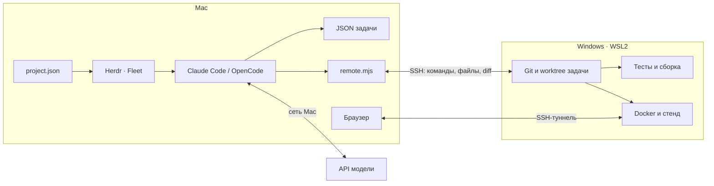

# Удалённый проект в Fleet

На Mac: Claude Code или OpenCode, авторизация модели, Herdr, трекер и API код-хоста, папка профиля и JSON задачи. На SSH-хосте: исходники, Git, worktree, установка, контейнеры, проверки и стенд. SSH нужен также для доступа к файлам. Монтирование и локальный клон не нужны.



## Подготовка и запуск

1. Проверь SSH из обычного неинтерактивного терминала Mac: `ssh -T -o BatchMode=yes dev-wsl hostname`. SSH-сессия должна видеть Git, Node, пакетный менеджер и Docker проекта. Пароли модельных провайдеров туда не копируй. Ключ хоста при первом подключении проверяет пользователь.
2. Разреши именованный профиль: `node <папка скилла>/scripts/resolve-project.mjs --project app`. Скрипт сверяет реальный корень и origin с `project.json`. Ошибка транспорта или несовпадение: стоп до подготовки и запуска, без локального fallback.
3. Оркестратор выполняет операции с основной копией через `node <папка скилла>/scripts/remote.mjs app -- <команда> [аргументы]`. Так выполняются шаги worktree, в том числе `git worktree list --porcelain`, `git fetch` под **удалённым** локом, установка и копирование файлов. Для операций в создаваемой копии перед привязкой используй `git -C <удалённый-путь>` или команду с явным cwd там. При восстановлении сначала сверь состояние, не повторяй подготовку с нуля.
4. В `launch.mjs` передавай `--project app --cwd <удалённый-worktree> --branch <ветка>` также при `--replace` и `--resume`. После проверки пути, origin и ветки скрипт фиксирует привязку в локальном `<dir>/control/<ID>/binding.json`. Это cwd терминала агента на Mac. В эту папку не копируют исходники. В JSON задачи `worktree` остаётся удалённым путём. Привязка живёт дольше панели и должна совпасть при продолжении.

## Работа сессии

Для **каждой** операции с кодом используй шлюз с `--task`. Шлюз передаёт argv и stdin через SSH и возвращает stdout, stderr и код выхода. Примеры из локального терминала (`R` это абсолютный путь к `scripts/remote.mjs`):

```sh
node "$R" app --task PROJ-1 -- cat src/example.txt
node "$R" app --task PROJ-1 -- git apply --check - < change.patch
node "$R" app --task PROJ-1 -- git apply - < change.patch
node "$R" app --task PROJ-1 -- pnpm --dir app/frontend test
node "$R" app --task PROJ-1 -- git status --short
node "$R" app --task PROJ-1 -- git diff origin/main...HEAD
node "$R" app --task PROJ-1 -- git diff HEAD
```

Патч готовь локально в служебной папке, подавай через stdin. `Read`, `Edit`, `Write`, локальный поиск, индексация и `EnterWorktree` на Mac не видят удалённый checkout. Инструкции репозитория, документы, `.handoff` и все пути карты читай через шлюз; тем же способом работают субагенты. Если инструмент или политика запрещает операцию, остановись. Не заменяй её локальной командой. Профиль, состояние и локальные инструкции скиллов читай на Mac.

Дифф показывай командой шлюза от merge-base с базой, включая staged и незакоммиченные изменения; для untracked перечисли `git ls-files --others --exclude-standard` и покажи содержимое отдельно. Пользователь может открыть тот же worktree в редакторе Remote SSH. Панель Review Herdr и локальный gitone сюда не направляй. Для fingerprint исполни оригинальный локальный скрипт в удалённом Node 24 через stdin: `node "$R" app --task PROJ-1 -- node --input-type=module - main < "$SKILLS/task-run/scripts/fingerprint.mjs"` (`$SKILLS` указывает на родительскую папку скиллов). Сверь отпечаток до и после показа.

Стенд и его портовый лок запускай в WSL, в `stand.cwd`; локальный путь к `stand.mjs` там недоступен, передай скрипт через stdin или установи ту же версию вспомогательных скриптов. Для браузера на Mac держи отдельный `ssh -NT -o ExitOnForwardFailure=yes -L 127.0.0.1:<локальный-порт>:127.0.0.1:<порт-стенда> <host>`; открывай локальный порт. На stop/show закрывай свой туннель и свой стенд, проверяй владельца на SSH-хосте. При потере сети отметь отложенную уборку до восстановления. Скриншоты из WSL переноси через stdout в локальную папку артефактов.

При обрыве SSH результат последней команды может быть неизвестен. Зафиксируй ожидание локально, не запускай команду ещё раз, не переключайся на локальный клон и не освобождай место живой сессии. После подключения сверь binding, ветку, рабочее дерево, для доставки также SHA/статус в код-хосте и `pending`/`outbound`. Только после сверки продолжай с первого невыполненного действия. Неясный результат требует ответа пользователя.

OpenCode: `--standalone` оставляет сервер у этой панели. Для входа через `@task-run` и `@task-estimate` обе команды должны быть доступны выбранному агенту; если политика закрывает `task-*`, разреши ровно эти два скилла после общего запрета. `task-fleet` вызывается в Claude. Если OpenCode не загрузил скилл, останови запуск, не считай задачу принятой. При вопросах используй инструмент вопросов текущего агента, при показе браузера в OpenCode используй `browse`.
